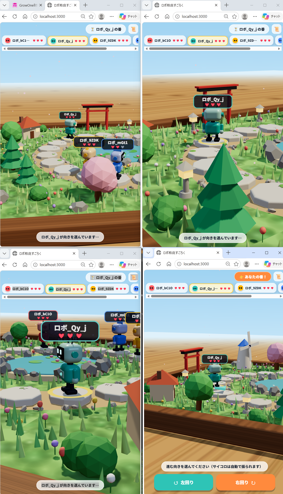

# ロボ箱庭すごろく (robo-sugoroku)

3D の箱庭（three.js）の石畳の上を、ミニロボットになって進むマルチプレイ対戦ゲームです。
サイコロで進み、ライバルとすれ違ったらミニバトル＝ジャンケン。
ライフを奪い合い、最後まで生き残った一体が勝ちです。


Node.js（Express + Socket.io）の **サーバ主導（server-authoritative）** 構成で、ゲームの進行はすべて `game.js` が決め、ブラウザは結果の再生と入力だけを担当します。

<!-- スクリーンショット（4プレイヤのプレイ画面）をここに追加

-->

## 特徴

- three.js で作った3D箱庭：石畳の輪、池と鯉、鳥居、小屋、風車、灯籠など。マウスで視点の回転・ズームします
- 色ごとに頭の飾りが違うミニロボット（2〜8体）
- ブラウザだけで遊べるマルチプレイ。CPU の追加、途中切断時の CPU 引き継ぎ、観戦に対応
- three.js を同梱しているため、CDN やビルド作業は不要

## セットアップ

必要なもの：Node.js 18 以上（Node 20 / 22 で動作確認）

```bash
git clone https://github.com/keith-river/robo-sugoroku.git
cd robo-sugoroku
npm install
node server.js
```

ブラウザで http://localhost:3000 を開きます。ポートを変えるときは `PORT=3200 node server.js`。
同じネットワークの他の端末からは `http://<サーバのIP>:3000` で参加できます。

## 遊び方

1. 名前を入力し、友だちを待つか **「＋ CPUを追加」** で人数を揃えて **「ゲーム開始」**（2〜8人）
2. 自分の番に **左回り / 右回り** を選ぶと、サイコロが自動で振られ、出た目の数だけ進みます
   - キーボード：`←` / `→`
3. ライバルと **同じ石に止まる**、または **通過した石にライバルがいる** とジャンケン
   - ボタンで グー / チョキ / パー を選びます（キーボード：`1` `2` `3` または `g` `c` `p`）
   - 勝者は相手のライフを1奪い、勝者のライフは増えません。あいこは決着まで繰り返し
4. 全員ライフ3でスタート。0になると脱落し、最後の生き残りが優勝。結果画面から「ロビーに戻る」で再戦

補足：
- 石は20枚の輪で、スタート位置はランダムです
- 同じ石に複数のライバルがいる場合は、参加順に1人ずつ対戦します
- 制限時間は向き選択25秒、ジャンケン14秒。超えるとランダムで進みます
- 途中で切断した人は CPU が引き継ぎます。ゲーム中の入室は観戦扱いで、ロビーに戻ると参加できます

## テスト

```bash
npm test
```

ゲームエンジン（`game.js`）のユニットテスト（node:test）を実行します。ランダムな300ゲームのシミュレーションを含みます。
開発時は `SUGOROKU_SPEED=0.35 node server.js` で演出時間と CPU の待ち時間を短縮できます。

## 構成

| ファイル | 役割 |
|---|---|
| `game.js` | 純粋なゲームエンジン。操作は `{ok, events, waitMs}` を返す。`snapshot()` で状態を返す（ジャンケンの手は決着まで非公開） |
| `server.js` | 通信とタイマー（CPU の操作・制限時間）のみ |
| `public/main.js` | Socket.io クライアント。events を1つずつキューで再生し、HUD と3D演出を同期 |
| `public/scene.js` | three.js の箱庭（石畳・池・鳥居・風車・ロボット・サイコロ・演出） |
| `public/vendor/three/` | 同梱の three.js（MIT） |
| `test/game.test.js` | エンジンのテスト |

### 通信プロトコル

- サーバ→クライアント：`update { state, events }`（`state` は最新スナップショット、`events` は再生すべき出来事）
  - events: `start, turn, roll, step, jankenStart, jankenRound, jankenEnd, eliminated, win, lobby, note`（各 `ms` が演出時間）
- クライアント→サーバ：`setName, addBot, removeBot, startGame, chooseDirection('cw'|'ccw'), chooseHand('rock'|'scissors'|'paper'), backToLobby`

石の番号は上から見て時計回りに増えます（`cw` = +1、`ccw` = −1、20で一周）。

## ライセンス

`license.txt` を参照してください。three.js は `public/vendor/three/LICENSE`（MIT）に従います。
